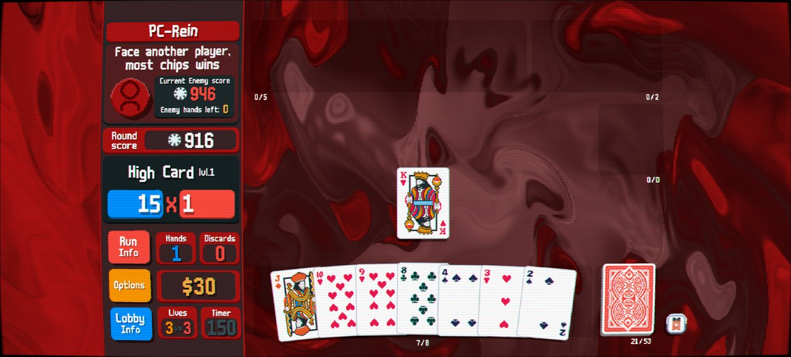
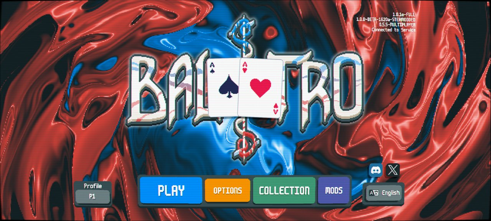
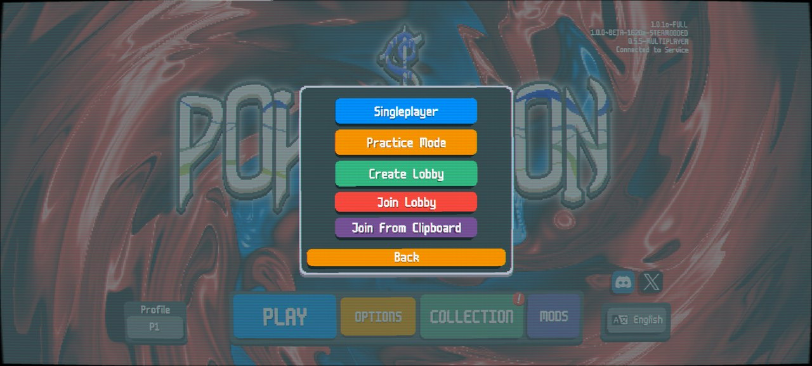
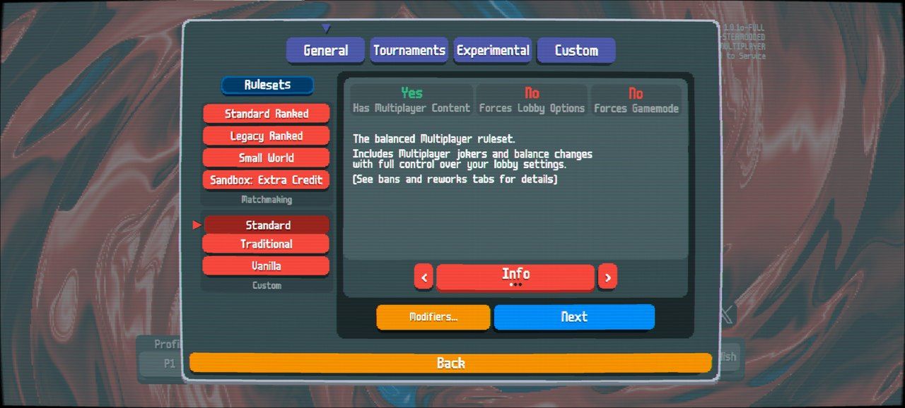
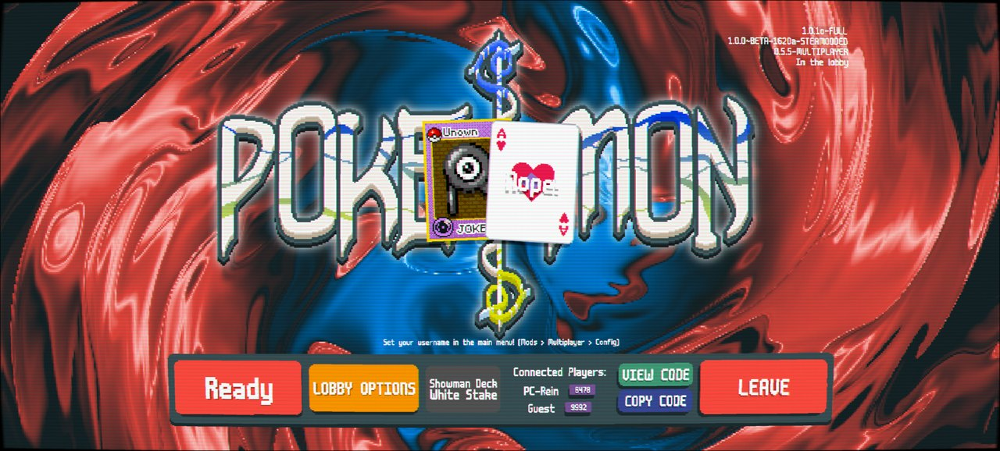
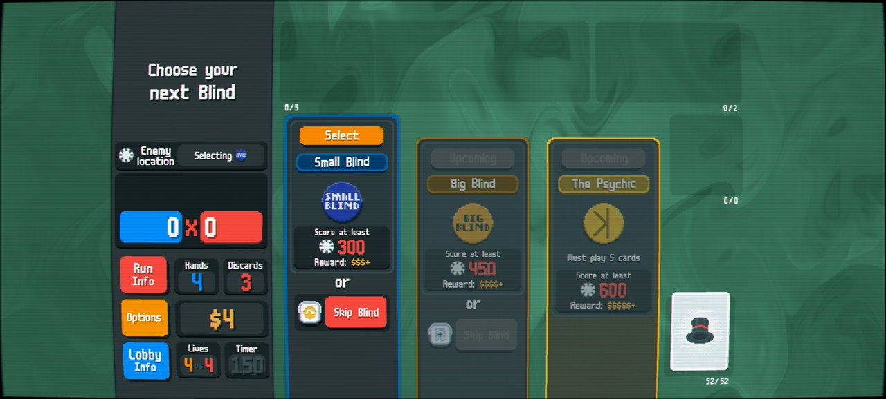
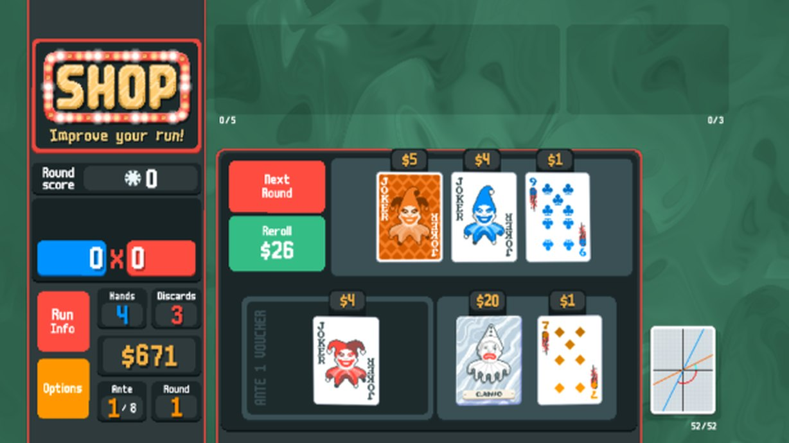
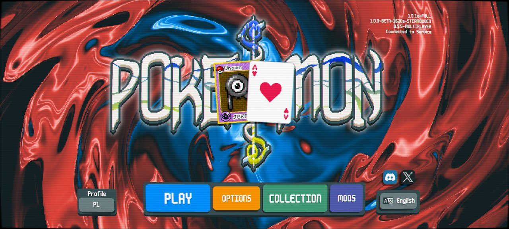
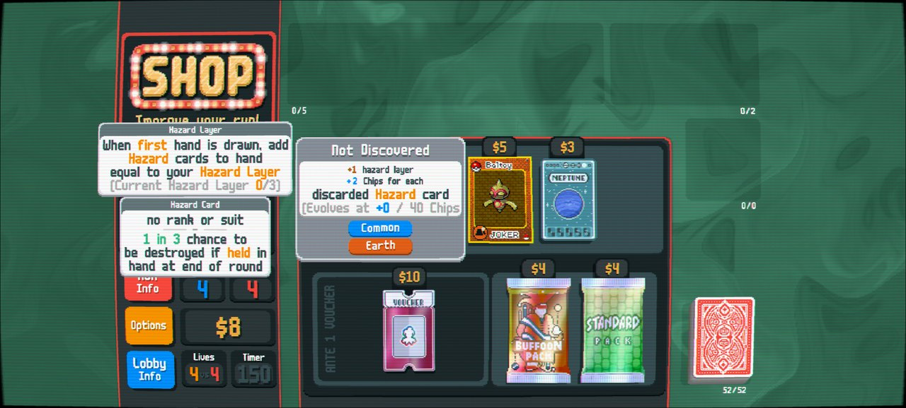
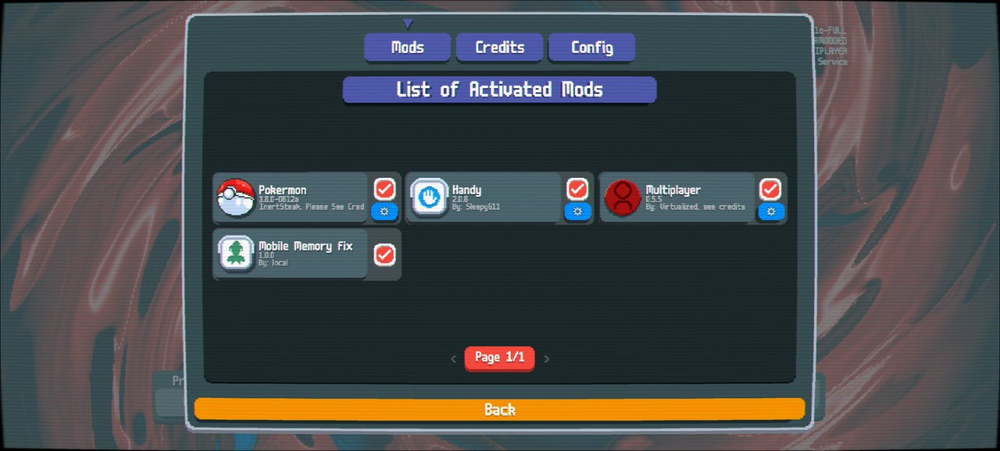

<div align="center">

# Shades of Balatro

**One command. Every mod. Play your friends.**

A pinned Balatro modpack and the tool that installs it. It sets up Lovely, Steamodded and the
Balatro Multiplayer mod with the same content mods on every PC: Pokermon, a deck dedicated to
Showman, stacking jokers and the Deck of Equilibrium. You and your friends end up with the
exact same versions and can meet in an online lobby. Switch between vanilla jokers, modded
jokers and everything at once with one preset command.

**Windows: run one line in PowerShell, or double-click `Shades-Setup.bat` from [Releases](https://github.com/Sayandeep1013/Shades-of-Balatro/releases).
Android: `ShadesOfBalatro.apk` on the same page, set up from your PC with `shades phone`.**



</div>

---

## Screenshots

| Title, mods loaded and online | Multiplayer menu | Rulesets |
|---|---|---|
|  |  |  |

| Lobby on the Showman Deck | Showman Deck run | Deck of Equilibrium shop |
|---|---|---|
|  |  |  |

| Pokermon title | Pokermon in a Multiplayer shop | Mods menu |
|---|---|---|
|  |  |  |

## What you get

- **The whole setup in one go.** It finds your Steam copy of Balatro, puts Lovely next to it,
  downloads every mod from its official release and switches on the preset you pick.
- **Everyone gets the same versions.** Every download is pinned and checked against a SHA-256 in
  [`modpack.json`](modpack.json). Multiplayer keeps two players in sync by giving both the same
  seed, so different mod versions mean different shops. Here, everyone gets the same files.
- **It checks and repairs.** `shades check` reports what's installed against the modpack.
  `shades install` fixes only what's wrong, and moves anything it replaces into a dated backup folder.
- **Presets for every mix.** Vanilla jokers, Pokermon, stacking jokers, everything at once, or
  plain Multiplayer. Mods are switched on and off, never deleted, so changing preset is instant.
- **Two mods written for this pack:**
  - **Mobile Memory Fix.** Pokermon's art takes about 2.4 GB of RAM once loaded, and Steamodded kept
    a second copy of every sprite sheet. On an 8 GB phone that meant ~2.7 GB in use and an
    out-of-memory kill, which looked like the whole phone crashing. The fix drops the spare copies and
    loads 1x art for oversized mods on phones only: about **1.0 GB, no swap, a 12 s load instead of 45 s**.
  - **Deck of Equilibrium.** Cryptid's deck on its own, with no Cryptid needed: every joker (Legendaries
    included), consumable, voucher, pack and playing card has the same chance in every shop slot, and
    you start with Overstock + Overstock Plus. Ported from Cryptid's GPL-3 source and art.
- **No more `naninf`.** [Amulet](https://github.com/frostice482/amulet) (the maintained
  continuation of Talisman) is in every content preset. Scores past vanilla's e308 limit show up as
  `1e400`, `ee12` and so on, where they used to break into `naninf`. It works with Multiplayer.
- **Nothing from Balatro is shared.** The tool never downloads or uploads game files. Each player
  uses their own copy.

## Presets

| Preset | What's on | For |
|---|---|---|
| `showman` *(default)* | Steamodded, Multiplayer, Handy, Amulet, Shenanigans's Decks, Card Sleeves, Deck of Equilibrium, Mobile Memory Fix | Modded decks (Showman, Equilibrium, 31 more) with the normal joker pool |
| `stacking` | `showman` + Stacking Jokers | Duplicates fold into one card and multiply it: 3x Photograph = X8 |
| `pokermon` | Steamodded, Multiplayer, Handy, Amulet, Pokermon, Mobile Memory Fix | Every joker is a Pokemon |
| `everything` | All of the above | Chaos |
| `vanilla-mp` | Steamodded, Multiplayer, Handy | Online play only. Pick the **Vanilla** ruleset for the untouched game |

Pure single-player vanilla needs no preset: the **Balatro (Vanilla)** shortcut starts the game with
Lovely's `--vanilla` switch and every mod off.

## Install on Windows

You need **Balatro on Steam** (1.0.1o) and Windows 10 or 11. Close the game first.

**Option 1: one line.** Open PowerShell (Start → type *PowerShell*) and paste:

```powershell
irm https://raw.githubusercontent.com/Sayandeep1013/Shades-of-Balatro/main/shades.ps1 | iex
```

**Option 2: double-click.** Download `Shades-Setup.bat` from
[Releases](https://github.com/Sayandeep1013/Shades-of-Balatro/releases) and run it.

Both open this menu:

```
  SHADES OF BALATRO
  1) Install / repair everything
  2) Check my setup
  3) Switch preset (which mods are on)
  4) Set up my Android phone (USB)
  5) Uninstall
  6) Quit
```

A full install from nothing takes about a minute and a half (Pokermon is a 55 MB download). It leaves:

- `Balatro` and `Balatro (Vanilla)` shortcuts on the Desktop and in the Start menu;
- a **Shades of Balatro** entry in the Start menu to check the setup or switch presets later;
- every replaced file in `%AppData%\Balatro\ShadesBackups\<date>`.

### Commands

To pass arguments to the one-liner, use the scriptblock form:

```powershell
& ([scriptblock]::Create((irm https://raw.githubusercontent.com/Sayandeep1013/Shades-of-Balatro/main/shades.ps1))) install -Preset stacking
```

or clone the repo and run `.\shades.ps1 <command>`:

| Command | Does |
|---|---|
| `install [-Preset <name>]` | Installs or repairs Lovely and every mod, then applies the preset |
| `check` | Lists Lovely and each mod: installed version, wanted version, on/off. Exit code 1 if anything is off |
| `preset <name>` | Switches which mods are on |
| `presets` | Lists presets and marks the current one |
| `phone` | Installs the app on a USB-connected Android phone and syncs your Balatro.exe, mods and preset |
| `uninstall` | Moves Lovely and the pack's mods to a backup folder. Balatro is vanilla again |

Options: `-GameDir <folder>` if Balatro isn't in a Steam library, `-ModsDir`, `-NoShortcuts`, `-Yes`.

Windows Defender sometimes flags Lovely's `version.dll`, because it's an injector. It's the official
build, and the installer refuses any file whose SHA-256 differs from the one pinned in `modpack.json`.

## Playing together

1. Both players install the same preset (`shades check` shows yours).
2. One player: **PLAY → Create Lobby →** pick **Standard**, **Traditional** or **Vanilla**
   from the *lower* list → **Attrition → Create Lobby**. Share the 5-letter code.
3. The other: **PLAY → Join Lobby →** type the code. In the game's pixel font, U/V and O/Q look alike.
4. The host taps the **deck button** to pick any deck (Showman Deck, Deck of Equilibrium...), then **Start**.

- **Ranked** (the top list) needs Lovely 0.9.x and approved mods only. PCs installed with this tool
  get Lovely 0.9.0, so Ranked works there with the `vanilla-mp` preset. Phones run Lovely 0.10 and
  can't join Ranked.
- **Set a username** under MODS → Multiplayer → Config.
- **Use a fully unlocked profile.** Locked jokers change your shop pool, so the lobby warns about
  them. Make a separate profile and press *Unlock All* in its profile screen (this turns off
  achievements on that profile), then restart the game once.
- **Check the number next to each name in the lobby.** It's a hash of each player's mod list. Equal
  numbers mean equal mods. Lovely 0.9 on PC and 0.10 on a phone change the number, but not the game.
- **Leaving the app mid-match:** the game reconnects if you come back within 60 seconds. After
  that the server ends the match.

## Android

The phone app is a **game-free APK**: LÖVE 11.5 with Lovely 0.10 built in, a small launcher and
nothing from Balatro. It runs **your own `Balatro.exe`**, taken from your PC.

**With a PC (recommended).** Plug the phone in with USB, then run option **4) Set up my Android
phone** from the menu, or:

```powershell
& ([scriptblock]::Create((irm https://raw.githubusercontent.com/Sayandeep1013/Shades-of-Balatro/main/shades.ps1))) phone
```

It downloads Google's adb, walks you through turning on USB debugging, installs
`ShadesOfBalatro.apk` from the latest [Release](https://github.com/Sayandeep1013/Shades-of-Balatro/releases)
(SHA-256 checked), copies your `Balatro.exe` into the app's private folder, mirrors your PC's mods
and preset, and starts the game. Run it again after switching presets so the phone matches.

**Without a PC.** Install `ShadesOfBalatro.apk` from Releases, open it once, then use
[Material Files](https://f-droid.org/packages/me.zhanghai.android.files/) (*menu → Add storage →
External storage → Shades of Balatro → Use this folder*) to copy your `Balatro.exe` into the app's
folder, and the mod folders into `Mods`. The app shows these steps if `Balatro.exe` is missing.

How the launcher works: `Balatro.exe` is a LÖVE game with a zip appended, so
[`android/launcher/conf.lua`](android/launcher/conf.lua) mounts it from the save folder before the
game starts. The game's own `main.lua` is then the only one, so it boots and Lovely patches it
exactly as on a normal install. The launcher ships no `main.lua` because Lovely appends Steamodded
to any file with that name.

The modpack itself was tested on an 8 GB phone (Snapdragon 7s Gen 3): Multiplayer hosting, joining,
PvP, reconnecting and saving all work, at 0.5-1.0 GB of RAM depending on the preset. The launcher
was verified on Windows with the same LÖVE 11.5; the first on-phone run of the APK is pending.
## The mods

| Mod | Version | What it adds | Licence |
|---|---|---|---|
| [Lovely](https://github.com/ethangreen-dev/lovely-injector) | 0.9.0 | The injector everything else runs on | MIT |
| [Steamodded](https://github.com/Steamodded/smods) | 1.0.0~BETA-1620a | Mod loader. The version Multiplayer standardises on | GPL-3.0 |
| [Balatro Multiplayer](https://balatromp.com) | 0.5.5 | Lobbies, PvP blinds, lives, rulesets | GPL-3.0 |
| [Handy](https://github.com/SleepyG11/HandyBalatro) | 2.0.6 | Speed and control shortcuts. Multiplayer-approved | GPL-3.0 |
| [Amulet](https://github.com/frostice482/amulet) | 3.6.1 | Scores above e308 instead of `naninf`. Talisman's maintained fork, with Multiplayer support | GPL-3.0 |
| [Pokermon](https://github.com/InertSteak/Pokermon) | 3.8.0 | Every joker is a Pokemon. The release built for Steamodded 1620a | GPL-3.0 |
| [Shenanigans's Decks](https://github.com/ShenanigansBunul/balatro-shenanigans-decks) | 1.2 | 31 decks including the **Showman Deck** | MIT |
| [Card Sleeves](https://github.com/larswijn/CardSleeves) | 1.9.4 | Sleeves, used by Shenanigans's Decks | GPL-3.0 |
| [Stacking Jokers](https://github.com/Michael-Andrzejewski/Stacking-Jokers) | 0.3.0 | Always-on Showman, duplicates stack and multiply. Made for Bean's videos | none published: downloaded, never redistributed |
| [Mobile Memory Fix](mods/MobileMemFix) | 1.0.0 | Phone RAM fix, written for this pack | GPL-3.0 |
| [Deck of Equilibrium](mods/EquilibriumDeck) | 1.0.0 | Cryptid's deck, standalone | GPL-3.0 |

Only the last two live in this repository. Everything else is fetched from its author's own
release when you install, so this repo never redistributes anyone's work.

**Want Cryptid?** Cryptid 0.5.17 needs Steamodded 26.829+, which is newer than the Steamodded
Multiplayer standardises on, so it's not in this pack. Amulet, the other thing it needs, is already
in the pack.

## How it's built

PowerShell 5.1 (built into Windows) for the installer, Lua for the two mods. No runtime to install.

```
shades.ps1            the installer: find Balatro, Lovely, pinned downloads + SHA-256, presets, shortcuts, check, phone, uninstall
Shades-Setup.bat      double-click wrapper that runs the latest shades.ps1
android/launcher/      conf.lua: mounts the player's Balatro.exe and hands over to the game
android/build-apk.sh  LMM base APK (pinned) + launcher + icon -> signed, game-free APK
android/icon/         original icon, drawn in code
.github/workflows/    builds and attaches the APK to every v* release
modpack.json          the pack: every mod's version, URL, SHA-256 and folder, plus the presets
mods/MobileMemFix/    frees spare sprite-sheet copies; 1x art for oversized mods on phones
mods/EquilibriumDeck/ Cryptid's Deck of Equilibrium on its own (shop hooks + save/load patch + deck art)
docs/screenshots/     taken on a Nothing Phone (3a) and a Windows PC while testing
```

How the installer works:

1. **Find the game:** reads Steam's `libraryfolders.vdf` from the registry and looks for
   `steamapps\common\Balatro\Balatro.exe` in every library. If that fails it asks for the folder.
2. **Lovely:** compares the `version.dll` next to the game with the pinned hash, and renames a
   newer `winmm.dll` Lovely out of the way, because two injectors stop the game from starting.
3. **Mods:** downloads each release into a cache and refuses it if the SHA-256 differs. It finds the
   mod's real folder by its marker file (Handy's zip has a stray `lovely.toml` at the root that
   crashes the game if copied), then swaps it in and keeps the old copy.
4. **Presets:** writes or removes `.lovelyignore` in each mod folder. That's the same switch the
   in-game MODS menu flips, so the two never disagree.

## Tested

| Check | PC | Phone |
|---|---|---|
| Fresh install from nothing, all 9 mods + Lovely | ✅ byte-identical to the hand-built working setup, ~80 s | n/a |
| Re-run install changes nothing; outdated mod repaired; corrupted download re-fetched; uninstall | ✅ | n/a |
| Vanilla, modded single player, Multiplayer | ✅ | ✅ |
| PC vs phone match on one seed: same bosses, shops, lives, PvP scores | ✅ | ✅ |
| Showman Deck in a Multiplayer lobby and run | ✅ | ✅ |
| Stacking Jokers math (3x Photograph = X8) | ✅ | not separately tested |
| Deck of Equilibrium: Overstock+, mixed pool, voucher/pack bought from a joker slot | ✅ | ✅ |
| Deck of Equilibrium: quit and continue mid-shop | ✅ | not separately tested |
| Pokermon without running out of memory | ✅ (~2.5 GB) | ✅ (~1.0 GB with Mobile Memory Fix) |
| Backgrounding the app mid-match, reconnecting | n/a | ✅ |
| Amulet: a hand worth e400 against an e500 blind shows `1e400`, not `naninf` | ✅ | ✅ |

## Status

| | |
|---|---|
| v1.0.0 | Windows installer, five presets, Mobile Memory Fix, Deck of Equilibrium |
| v1.1.0 | Game-free Android APK built in CI; `shades phone` installs it over USB with your own `Balatro.exe`, mods and preset |
| v1.2.0 | Amulet added to every content preset: no more `naninf` above e308 |
| Next | Confirm the APK on more phones; an in-app file picker for `Balatro.exe` |

## Credits

- **Balatro** by LocalThunk, published by Playstack. This project isn't affiliated with them, and it
  needs your own copy of the game.
- [Lovely](https://github.com/ethangreen-dev/lovely-injector) (ethangreen-dev and contributors) and
  [Lovely Mobile Maker](https://github.com/WilsontheWolf/lovely-mobile-maker) (WilsontheWolf).
- [Steamodded](https://github.com/Steamodded/smods), [Balatro Multiplayer](https://github.com/Balatro-Multiplayer/BalatroMultiplayer)
  (Virtualized and contributors), [Handy](https://github.com/SleepyG11/HandyBalatro) (SleepyG11),
  [Amulet](https://github.com/frostice482/amulet) (frostice482, from Talisman by MathIsFun_ and the SpectralPack team),
  [Pokermon](https://github.com/InertSteak/Pokermon) (InertSteak), [Shenanigans's Decks](https://github.com/ShenanigansBunul/balatro-shenanigans-decks)
  (Shenanigans), [Card Sleeves](https://github.com/larswijn/CardSleeves) (Larswijn),
  [Stacking Jokers](https://github.com/Michael-Andrzejewski/Stacking-Jokers) (Soareverix).
- **Deck of Equilibrium** code and art from [Cryptid](https://github.com/SpectralPack/Cryptid)
  (MathIsFun_ and the Cryptid team), GPL-3.0.
- Inspired by [Bean](https://www.youtube.com/@BeanBalatro)'s modded Multiplayer videos.

## Licence

GPL-3.0. See [LICENSE](LICENSE). The mods the installer downloads keep their own licences.
